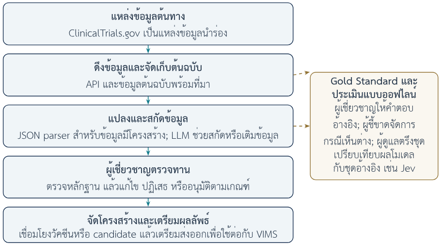
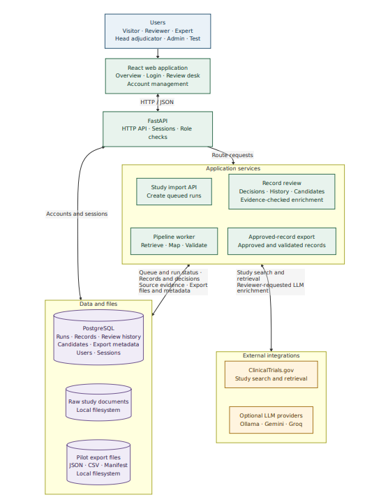
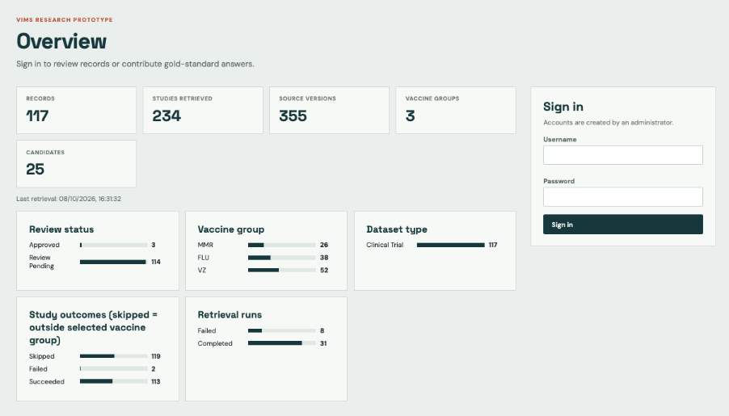
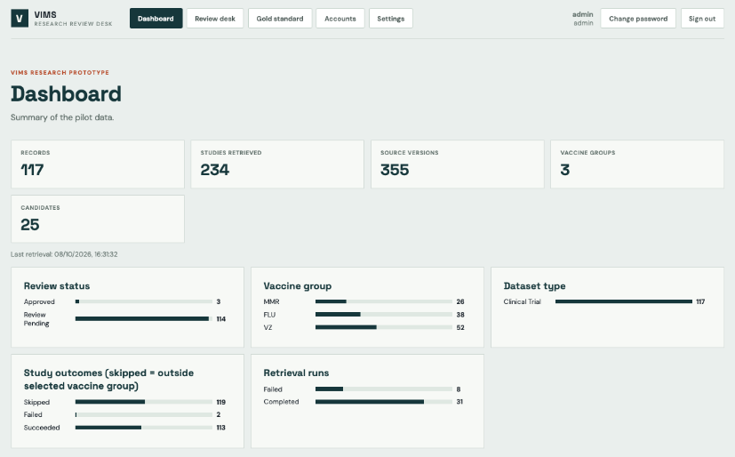
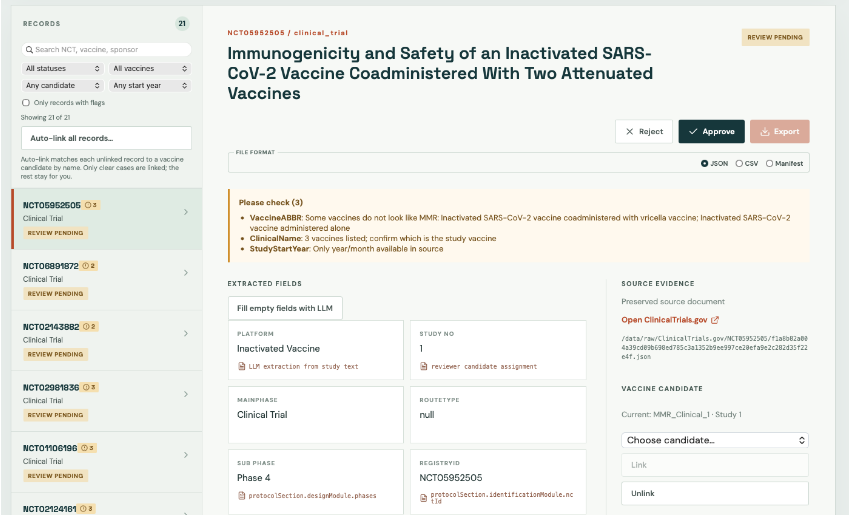
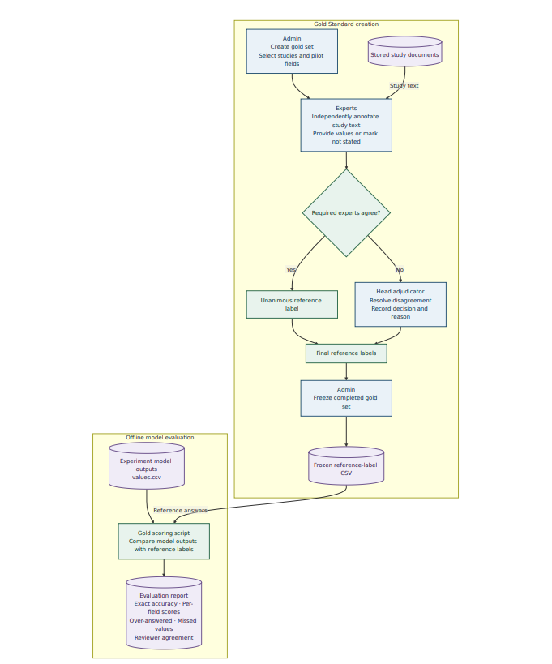
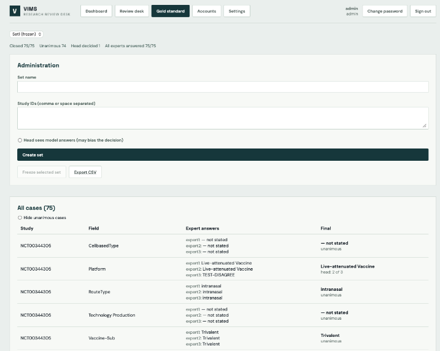

---

marp: true
theme: mahidol
size: 16:9
paginate: true
title: 'ความก้าวหน้าระบบ VARD'
author: 'คณะวิศวกรรมศาสตร์ มหาวิทยาลัยมหิดล'
footer: 'VARD · ความก้าวหน้าระบบต้นแบบ'

---

<!-- _class: lead -->
<!-- _paginate: false -->

# ความก้าวหน้าระบบ VARD

ฉบับละเอียด: ระบบต้นแบบและผลประเมินเบื้องต้น

ระบบอัตโนมัติเพื่อทบทวนและรวบรวมข้อมูลการวิจัยพัฒนาวัคซีน และผลิตภัณฑ์วัคซีนด้วยปัญญาประดิษฐ์

**ผศ.ดร. ทวีศักดิ์ สมานชื่น** หัวหน้าโครงการ 
คณะวิศวกรรมศาสตร์ มหาวิทยาลัยมหิดล

อ้างอิงรายงานเชิงเทคนิควันที่ 29 ตุลาคม 2569

<!-- ข้อมูลชื่อผู้วิจัยและหน่วยงาน: main(3).pdf วันที่ 29 ตุลาคม 2569 หน้าปก; แหล่งทุนตามข้อเสนอ: สถาบันวัคซีนแห่งชาติ; NRIIS 4863782 -->

---

## เนื้อหาการนำเสนอ

1. ที่มา วัตถุประสงค์ และขอบเขตโครงการ
2. ภาพรวมและสถาปัตยกรรมระบบ VARD
3. กระบวนการรวบรวม สกัด และตรวจทานข้อมูล
4. ตัวอย่างหน้าจอและการใช้งานระบบต้นแบบ
5. การสร้าง Gold Standard และผลประเมิน AI เบื้องต้น
6. สถานะปัจจุบัน ข้อจำกัด และแผนพัฒนาระยะถัดไป

<!-- แหล่งข้อมูล: agenda.md -->

---

<!-- _class: divider -->

## 01
## ที่มา วัตถุประสงค์ และขอบเขตโครงการ

Project rationale and scope

---

## ที่มาและปัญหาที่โครงการต้องการแก้

### ข้อมูลวิจัยวัคซีนกระจายในหลายแหล่ง

- รูปแบบข้อมูลต่างกัน ทำให้รวบรวมและเปรียบเทียบได้ยาก
- ต้องจัดโครงสร้างและใช้คำศัพท์ให้สอดคล้องกัน
- ทุกค่าควรตรวจย้อนกลับถึงเอกสารและหลักฐานต้นฉบับได้

> โครงการเตรียมข้อมูลเพื่อสนับสนุนระบบข้อมูลและบริหารจัดการวัคซีน (VIMS) ของสถาบันวัคซีนแห่งชาติ

<!-- แหล่งข้อมูล: main(3).pdf รายงานความก้าวหน้าเชิงเทคนิค วันที่ 29 ตุลาคม 2569 หัวข้อ 1.1 -->

---

## วัตถุประสงค์และบทบาทของ VARD

<b>รวบรวม</b>ข้อมูลและต้นฉบับ
<i>→</i>

<b>สกัด</b>กฎร่วมกับ AI
<i>→</i>

<b>ตรวจทาน</b>ผู้เชี่ยวชาญและหลักฐาน
<i>→</i>

<b>เตรียมใช้</b>ข้อมูลสำหรับ VIMS

- จัดข้อมูลตามโครงสร้าง พร้อมหลักฐานและประวัติการแก้ไข
- ใช้ AI ช่วยงาน โดยผู้เชี่ยวชาญตรวจรับข้อมูลก่อนนำไปใช้

การส่งออกไฟล์ยังไม่เท่ากับการเชื่อมต่อ VIMS ที่เสร็จสมบูรณ์

<!-- แหล่งข้อมูล: main(3).pdf รายงานความก้าวหน้าเชิงเทคนิค วันที่ 29 ตุลาคม 2569 หัวข้อ 1.1–1.3 และ 2.5 -->

---

## ขอบเขตข้อมูลและกลุ่มวัคซีนนำร่อง

| หมวดข้อมูล | พจนานุกรมฉบับร่าง | สถานะตามรายงาน |
|---|---:|---|
| พรีคลินิก | 17 ฟิลด์ | งานขยายระยะถัดไป |
| การทดลองทางคลินิก | 22 ฟิลด์ | ต้นแบบและผลประเมินนำร่อง |
| การขึ้นทะเบียน | 19 ฟิลด์ | งานขยายระยะถัดไป |
| ผลิตภัณฑ์วัคซีนทั่วโลก | 36 ฟิลด์ | งานขยายระยะถัดไป |

**กลุ่มนำร่อง:** MMR, VZ และ FLU 
ต้นแบบที่รายงานเน้นข้อมูลทางคลินิกจาก ClinicalTrials.gov

<!-- แหล่งข้อมูล: main(3).pdf รายงานความก้าวหน้าเชิงเทคนิค วันที่ 29 ตุลาคม 2569 หัวข้อ 1.2, 2.4.2 และ 4.3 -->

---

<!-- _class: detail-table -->

## มาตรฐานข้อมูลที่ต้องยืนยันกับ VIMS

| ประเด็น | สิ่งที่ต้องตกลงให้ตรงกัน |
|---|---|
| นิยามฟิลด์ | ความหมาย ขอบเขต และแหล่งหลักฐานที่ยอมรับ |
| ชนิดและรูปแบบข้อมูล | วันที่ ปี ตัวเลข ข้อความ และรูปแบบค่าว่าง |
| คำศัพท์ควบคุม | สถานะการศึกษา ระยะ แพลตฟอร์ม และวิธีให้วัคซีน |
| ตัวระบุและความสัมพันธ์ | รหัสงานวิจัย วัคซีน และ vaccine candidate |
| การส่งออก | ฟิลด์บังคับ/ไม่บังคับ และตารางเทียบกับ VIMS |

พจนานุกรมฉบับร่างมีชื่อและชนิดข้อมูลต่างรูปแบบ เช่น MainPhase/Mainphase จึงต้องยืนยันชื่อมาตรฐานและ mapping ก่อนเชื่อมต่อจริง

<!-- แหล่งข้อมูล: main(3).pdf รายงานความก้าวหน้าเชิงเทคนิค วันที่ 29 ตุลาคม 2569 หัวข้อ 2.4.2 และ 4.4 -->

---

<!-- _class: divider -->

## 02
## ภาพรวมและสถาปัตยกรรมระบบ VARD

System overview and architecture

---

<!-- _class: concept-overview -->

## กรอบแนวคิดภาพรวมของระบบ

เส้นทึบ: กระบวนการจัดเตรียมข้อมูลหลัก · เส้นประ: สร้างชุดอ้างอิงและเปรียบเทียบผลโมเดลแบบออฟไลน์

<!-- แหล่งข้อมูล: main(3).pdf รายงานความก้าวหน้าเชิงเทคนิค วันที่ 29 ตุลาคม 2569 หัวข้อ 2.3 ภาพที่ 2.1 -->

---

<!-- _class: large-workflow -->

## สถาปัตยกรรมระบบต้นแบบ

<h3>ส่วนติดต่อและประมวลผล</h3>

React สำหรับผู้ใช้ FastAPI รับคำขอ worker จัดคิวและประมวลผลเบื้องหลัง

<h3>ข้อมูลและบริการภายนอก</h3>

PostgreSQL และระบบไฟล์ ClinicalTrials.gov และบริการ LLM เลือกประมวลผลในเครื่องหรือคลาวด์

สถาปัตยกรรมตามเอกสารต้นแบบ ยังต้องทดสอบสิทธิ์และกระบวนการครบวงจร

<!-- แหล่งข้อมูล: main(3).pdf รายงานความก้าวหน้าเชิงเทคนิค วันที่ 29 ตุลาคม 2569 หัวข้อ 2.5 ภาพที่ 2.2 -->

---

<!-- _class: detail-table -->

## บทบาทผู้ใช้ในงานตรวจทานและชุดอ้างอิง

| บทบาท | หน้าที่ตามเอกสาร | ผลลัพธ์หลัก |
|---|---|---|
| admin | จัดบัญชี/บทบาท และจัดการชุดอ้างอิง | สิทธิ์ผู้ใช้และชุดงาน |
| reviewer | ตรวจ แก้ไข ปฏิเสธ หรืออนุมัติระเบียน | ข้อมูลที่เตรียมนำไปใช้งาน |
| expert | อ่านต้นฉบับและให้คำตอบอ้างอิงอย่างอิสระ | คำตอบและหลักฐานรายฟิลด์ |
| head adjudicator | ตัดสินกรณีผู้เชี่ยวชาญเห็นต่าง | คำตอบสุดท้ายและเหตุผล |

> การตรวจแก้ข้อมูลใช้งานและการสร้างเกณฑ์ประเมินโมเดลเป็นคนละกระบวนการ

ตารางนี้อธิบายการออกแบบบทบาท ยังต้องมีผลทดสอบการบังคับใช้สิทธิ์จริง

<!-- แหล่งข้อมูล: main(3).pdf รายงานความก้าวหน้าเชิงเทคนิค วันที่ 29 ตุลาคม 2569 หัวข้อ 2.4 ตาราง 2.5 และ 2.6 -->

---

<!-- _class: divider -->

## 03
## กระบวนการรวบรวม สกัด และตรวจทานข้อมูล

Data collection, extraction and review

---

## การนำเข้าและจัดโครงสร้างข้อมูล

1. ค้นหาและดึงระเบียนจาก ClinicalTrials.gov ผ่าน API
2. เก็บ JSON ต้นฉบับ ข้อมูลแหล่งที่มา และ content hash
3. จับคู่ฟิลด์กับพจนานุกรมฉบับร่างและตรวจสอบตามกฎ
4. เชื่อมระเบียนกับวัคซีนหรือ vaccine candidate

content hash ช่วยตรวจสอบเนื้อหาต้นฉบับ ส่วนจำนวนที่ดึง อนุมัติ และส่งออกจริงยังไม่มีตัวเลขยืนยันในรายงาน

<!-- แหล่งข้อมูล: main(3).pdf รายงานความก้าวหน้าเชิงเทคนิค วันที่ 29 ตุลาคม 2569 หัวข้อ 2.4–2.5 -->

---

## การเก็บที่มาและประวัติของข้อมูล

<h3>ต้นฉบับ</h3>
JSON จากแหล่งข้อมูล ตำแหน่งไฟล์และ content hash

<h3>ระเบียน</h3>
ค่าที่จับคู่หรือสกัด ประเด็น validation และรุ่นข้อมูล

<h3>การตัดสินใจ</h3>
ค่าก่อน–หลัง เหตุผล ประวัติการอนุมัติและชุดส่งออก

- PostgreSQL เก็บข้อมูลที่จัดโครงสร้างและข้อมูลกำกับ
- ระบบไฟล์เก็บเอกสารต้นฉบับและไฟล์ส่งออกของต้นแบบ

content hash ช่วยตรวจสอบเนื้อหา ส่วนแผนสำรอง กู้คืน และติดตามระบบจริงยังต้องกำหนดเพิ่มเติม

<!-- แหล่งข้อมูล: main(3).pdf รายงานความก้าวหน้าเชิงเทคนิค วันที่ 29 ตุลาคม 2569 หัวข้อ 2.4–2.5 และภาคผนวก A -->

---

## ขอบเขตงานของกฎและ LLM

<h3>JSON parser และกฎ</h3><ul><li>อ่านฟิลด์ที่มีโครงสร้างจากต้นทาง</li><li>จับคู่ชื่อและรูปแบบข้อมูล</li><li>ตรวจเงื่อนไขตาม pilot schema</li></ul>

<h3>LLM ที่เรียกตามคำขอ</h3><ul><li>ช่วยตีความข้อความเพื่อเติมช่องว่าง</li><li>เสนอค่าพร้อมข้อความหลักฐาน</li><li>ให้ผู้ตรวจทานพิจารณาก่อนรับค่า</li></ul>

> ข้อมูลที่อ่านจากต้นทางได้โดยตรงและข้อมูลที่ AI เสนอควรมีที่มาให้ตรวจสอบได้

LLM เป็นบริการเสริมในต้นแบบ ไม่ได้แทนการจับคู่ฟิลด์และการตรวจทานทั้งหมด

<!-- แหล่งข้อมูล: main(3).pdf รายงานความก้าวหน้าเชิงเทคนิค วันที่ 29 ตุลาคม 2569 หัวข้อ 2.4–2.5 -->

---

## การใช้ AI ช่วยสกัดและเติมข้อมูล

### เติมเฉพาะช่องว่างตามคำขอของผู้ตรวจทาน

- โมเดลภาษาขนาดใหญ่ (LLM) เสนอค่าพร้อมข้อความอ้างอิง
- ระบบตรวจว่าข้อความอ้างอิงปรากฏในเอกสารต้นฉบับ
- ผู้เชี่ยวชาญตรวจว่าหลักฐานสนับสนุนความหมายของค่านั้นจริง
- กระบวนการเติมข้อมูลไม่เขียนทับค่าที่มีอยู่

> การพบข้อความตรงต้นฉบับยังไม่เพียงพอที่จะยืนยันว่าค่าที่ AI เสนอถูกต้อง

<!-- แหล่งข้อมูล: main(3).pdf รายงานความก้าวหน้าเชิงเทคนิค วันที่ 29 ตุลาคม 2569 หัวข้อ 2.5 -->

---

<!-- _class: detail-table -->

## การพบข้อความกับการมีหลักฐานสนับสนุน

ตัวอย่างสมมติเพื่ออธิบายหลักการ ไม่ใช่ผลทดลองรายกรณีของโครงการ

**ข้อความต้นฉบับสมมติ:** “Participants received Vaccine A; Vaccine B was used as a comparator.”

| สิ่งที่ AI เสนอ | สิ่งที่ต้องตรวจ |
|---|---|
| วัคซีนที่ศึกษา = Vaccine B | คำว่า Vaccine B มีอยู่จริง แต่กล่าวถึงตัวเปรียบเทียบ |
| หลักฐานผ่านการค้นข้อความ | ยังต้องพิจารณาบริบทและนิยามของฟิลด์ |

> พบคำในต้นฉบับแล้ว ยังต้องตรวจว่าข้อความนั้นรองรับค่าของฟิลด์ที่กำลังสกัดจริง

<!-- แหล่งข้อมูล: main(3).pdf รายงานความก้าวหน้าเชิงเทคนิค วันที่ 29 ตุลาคม 2569 หัวข้อ 2.5; ตัวอย่างสมมติเพื่ออธิบาย -->

---

## การตรวจทานโดยผู้เชี่ยวชาญและการส่งออก

<h3>Human-in-the-Loop</h3>

ตรวจหลักฐาน แก้ไข ปฏิเสธ หรืออนุมัติ เก็บค่าก่อน–หลัง เหตุผล และรุ่นของระเบียน

<h3>ข้อมูลที่เตรียมส่งออก</h3>

รับเฉพาะระเบียนที่อนุมัติและผ่าน validation ส่งออกเป็น JSON, CSV และ manifest

> ประวัติการตัดสินใจช่วยให้ตรวจสอบย้อนกลับได้

ยังต้องยืนยัน export mapping และทดสอบการเชื่อมต่อกับเจ้าของข้อมูล VIMS

<!-- แหล่งข้อมูล: main(3).pdf รายงานความก้าวหน้าเชิงเทคนิค วันที่ 29 ตุลาคม 2569 หัวข้อ 2.5 -->

---

<!-- _class: divider -->

## 04
## ตัวอย่างหน้าจอและการใช้งานระบบต้นแบบ

Prototype screens and review journey

---

## ตัวอย่างหน้าจอและเส้นทางการใช้งาน

<b>ภาพรวมและลงชื่อเข้าใช้</b><b>แดชบอร์ดผู้ดูแล</b>

<b>ตรวจหลักฐาน แก้ไขหรืออนุมัติ แล้วส่งออก</b>

ตัวอย่าง NCT05952505 อยู่ในสถานะ Review Pending ตัวเลขบนหน้าจอไม่ใช่ยอดการใช้งานจริงที่ยืนยันแล้ว

<!-- แหล่งข้อมูล: main(3).pdf รายงานความก้าวหน้าเชิงเทคนิค วันที่ 29 ตุลาคม 2569 หัวข้อ 2.7 -->

---

## ตัวอย่างการตรวจหนึ่งระเบียนก่อนอนุมัติ

### จุดตรวจจากภาพ NCT05952505

1. ตรวจวัคซีนที่ศึกษาให้ต่างจากวัคซีนที่ให้ร่วม/ตัวเปรียบเทียบ
2. พิจารณาคำเตือนเรื่องความสอดคล้องของกลุ่มวัคซีนและ candidate
3. ตรวจความละเอียดของวันที่เริ่มศึกษาเมื่อแหล่งข้อมูลมีเพียงปี/เดือน
4. เปิดต้นฉบับ แก้ไขหรือคงค่า พร้อมบันทึกเหตุผลก่อนตัดสินใจ

> เมื่อข้อมูลผ่านการอนุมัติและ validation แล้ว จึงเตรียมส่งออก

เป็นเส้นทางตรวจทานที่อธิบายจากภาพต้นแบบ ไม่ใช่บันทึกว่าระเบียนนี้ได้รับการแก้ไขหรืออนุมัติจริง

<!-- แหล่งข้อมูล: main(3).pdf รายงานความก้าวหน้าเชิงเทคนิค วันที่ 29 ตุลาคม 2569 หัวข้อ 2.7 -->

---

<!-- _class: divider -->

## 05
## การสร้าง Gold Standard และผลประเมิน AI เบื้องต้น

Reference data and preliminary AI evaluation

---

## หลักการของ Gold Standard

ชุดคำตอบอ้างอิงที่ผู้เชี่ยวชาญตรวจสอบ เพื่อใช้ประเมินความถูกต้องของข้อมูลที่ AI สกัด

<h3>1. กำหนดเกณฑ์ให้ตรงกัน</h3>
นิยามฟิลด์ รูปแบบคำตอบ และกรณีที่เอกสารไม่ระบุข้อมูล

<h3>2. ยึดหลักฐานต้นฉบับ</h3>
ทุกค่าต้องมีข้อความสนับสนุนและตรวจสอบย้อนกลับได้

<h3>3. ให้คำตอบอย่างอิสระ</h3>
ผู้เชี่ยวชาญไม่เห็นคำตอบของ AI หรือผู้เชี่ยวชาญคนอื่น

<h3>4. ชี้ขาดเมื่อเห็นต่าง</h3>
ผู้ชี้ขาดตรวจหลักฐานและบันทึกคำตอบพร้อมเหตุผล

<h3>5. ตรึงชุดก่อนประเมิน</h3>
ควบคุมรุ่น และแยกชุดประเมินจากข้อมูลที่ใช้ปรับ prompt

<h3>6. วิเคราะห์ข้อผิดพลาด</h3>
แยกค่าผิด เติมเกิน ตกหล่น และกรณีค่าว่างรายฟิลด์

ชุดอ้างอิงยังอาจมีข้อผิดพลาด จึงต้องเก็บหลักฐาน ตรวจทาน และควบคุมรุ่น

<!-- แหล่งข้อมูล: main(3).pdf รายงานความก้าวหน้าเชิงเทคนิค วันที่ 29 ตุลาคม 2569 หัวข้อ 2.6, 3.2 และ 4.4 -->

---

<!-- _class: detail-table -->

## การออกแบบชุด Gold Standard ให้ประเมินได้

| ก่อนเริ่มให้คำตอบ | รายละเอียดที่ควรกำหนด |
|---|---|
| ขอบเขตตัวอย่าง | กลุ่มวัคซีน แหล่งเอกสาร ฟิลด์ และเกณฑ์คัดเลือก |
| คู่มือการให้คำตอบ | นิยามฟิลด์ คำศัพท์ที่ยอมรับ และกรณีไม่ระบุข้อมูล |
| ความเป็นอิสระ | ผู้เชี่ยวชาญไม่เห็นผล AI หรือคำตอบของกันและกัน |
| การจัดการข้อขัดแย้ง | กติกาส่งชี้ขาดและการบันทึกเหตุผล |
| การประเมินรอบใหม่ | ตรึงรุ่นและแยกชุดพัฒนาออกจากชุดประเมิน |

รายงานมี pilot 15 งานวิจัย 5 ฟิลด์ แต่ยังต้องแนบรายชื่อ เกณฑ์คัดเลือก และการกระจาย MMR/VZ/FLU เพื่อยืนยัน coverage

<!-- แหล่งข้อมูล: main(3).pdf รายงานความก้าวหน้าเชิงเทคนิค วันที่ 29 ตุลาคม 2569 หัวข้อ 2.6 และ 4.4; แนวทางเตรียมประเมินรอบถัดไป -->

---

<!-- _class: large-workflow -->

## กระบวนการสร้าง Gold Standard

<h3>จากต้นฉบับสู่คำตอบอ้างอิง</h3>
<ol><li>ผู้ดูแลเลือกงานวิจัยและฟิลด์</li><li>ผู้เชี่ยวชาญให้คำตอบอย่างอิสระ</li><li>ผู้ชี้ขาดพิจารณากรณีเห็นต่าง</li><li>ผู้ดูแลตรึงชุดก่อนประเมินโมเดล</li></ol>

<strong>Set1 ตามรายงาน</strong> 74 กรณีเห็นตรงกัน 1 กรณีชี้ขาด

ยังไม่มี annotations และบันทึกการชี้ขาดรายกรณีให้ตรวจยืนยันซ้ำ

<!-- แหล่งข้อมูล: main(3).pdf รายงานความก้าวหน้าเชิงเทคนิค วันที่ 29 ตุลาคม 2569 หัวข้อ 2.6 -->

---

<!-- _class: detail-table -->

## คำตอบอ้างอิงหนึ่งกรณีควรมีอะไรบ้าง

ตัวอย่างสมมติของรายการ annotation เพื่ออธิบายโครงสร้างการบันทึก

| รายการ | ตัวอย่าง |
|---|---|
| ชุด / งานวิจัย / ฟิลด์ | Gold-v1 / STUDY-EXAMPLE / Platform |
| คำตอบผู้เชี่ยวชาญ | Inactivated Vaccine |
| หลักฐานต้นฉบับ | “The investigational product is an inactivated vaccine.” |
| สถานะ | มีข้อมูลในต้นฉบับ หรือ “ไม่ระบุข้อมูล” |
| ผู้ให้คำตอบและเหตุผล | ระบุผู้เชี่ยวชาญ พร้อมคำอธิบายที่ตรวจย้อนกลับได้ |

ตัวอย่างนี้ไม่ใช่คำตอบจริงจาก Set1 ส่วนผลและหลักฐานรายกรณีของ Set1 ยังต้องแนบเพื่อตรวจยืนยัน

<!-- แหล่งข้อมูล: main(3).pdf รายงานความก้าวหน้าเชิงเทคนิค วันที่ 29 ตุลาคม 2569 หัวข้อ 2.6 และภาคผนวก A; ตัวอย่างสมมติเพื่ออธิบาย -->

---

<!-- _class: detail-table -->

## ตัวอย่างการเห็นต่างและการชี้ขาด

ตัวอย่างสมมติเพื่ออธิบายขั้นตอน ไม่ใช่กรณีชี้ขาด 1 กรณีที่รายงานใน Set1

| ขั้นตอน | การพิจารณา |
|---|---|
| ผู้เชี่ยวชาญให้คำตอบ | คำตอบหนึ่งเป็นค่าแพลตฟอร์ม อีกคำตอบเป็น “ไม่ระบุข้อมูล” |
| ตรวจรูปแบบ | ปรับตัวพิมพ์ ขีดเชื่อม และช่องว่างตามกติกา |
| ส่งชี้ขาดหากยังต่าง | อ่านหลักฐาน นิยามฟิลด์ และขอบเขตของวัคซีนที่ศึกษา |
| บันทึกข้อยุติ | คำตอบสุดท้าย พร้อมหลักฐานและเหตุผล |

> ผู้ชี้ขาดตรวจความหมายจากหลักฐาน ไม่ควรเลือกตามคำตอบของ AI

เมื่อจัดการข้อขัดแย้งครบแล้วจึงตรึงชุดและนำไปประเมินแบบออฟไลน์

<!-- แหล่งข้อมูล: main(3).pdf รายงานความก้าวหน้าเชิงเทคนิค วันที่ 29 ตุลาคม 2569 หัวข้อ 2.6; ตัวอย่างเพื่ออธิบายกระบวนการ -->

---

## หน้าจัดการชุดอ้างอิงและผลการชี้ขาด

<h3>สิ่งที่เห็นในภาพต้นแบบ</h3>
เลือกชุดอ้างอิงและดูสถานะ กำหนดชื่อชุดและรหัสงานวิจัย ตรึงชุดและส่งออก CSV

<h3>ตารางคำตอบรายกรณี</h3>
แสดงคำตอบผู้เชี่ยวชาญ คำตอบสุดท้าย และกรณีที่ชี้ขาด

ภาพจากภาคผนวก B ใช้อธิบาย UI เท่านั้น ยังไม่ยืนยันรุ่นระบบ การบังคับใช้สิทธิ์ หรือการทำงานครบวงจร

<!-- แหล่งข้อมูล: main(3).pdf รายงานความก้าวหน้าเชิงเทคนิค วันที่ 29 ตุลาคม 2569 หัวข้อ 2.6 และภาคผนวก B -->

---

<!-- _class: d6-method -->

## กรอบการประเมินผลนำร่อง

15 งานวิจัย × 5 ช่องข้อมูล

รวม **75 กรณีต่อโมเดล** จากข้อมูลการทดลองทางคลินิก

- เปรียบเทียบคำตอบของ 7 โมเดลข้อความกับคำตอบอ้างอิงของผู้เชี่ยวชาญ
- นับคำตอบที่ตรงกัน (exact match) พร้อมแยกค่าผิด ตอบเกิน และข้อมูลตกหล่น
- Jev เลือกจากรายการคำตอบที่กำหนดไว้ จึงรายงานแยกจากโมเดลข้อความ

คะแนนรวมกรณีที่ต้นฉบับไม่มีข้อมูล จึงต้องแยกกรณีมีข้อมูลจริงก่อนสรุปความสามารถในการสกัด ผลยังเป็นการประเมินนำร่อง ต้องขยายชุดข้อมูลและตรวจซ้ำก่อนยืนยันความพร้อมใช้งาน

<!-- แหล่งข้อมูล: main(3).pdf วันที่ 29 ตุลาคม 2569 หัวข้อ 3.2 ตาราง 3.2–3.3; รวมเนื้อหาจาก D5 หน้า 29–31 -->

---

<!-- _class: d3-exact-full -->

## ผล exact match ของโมเดลข้อความบน Set1

กรณีงานวิจัย–ฟิลด์ 75 กรณีต่อการตั้งค่า · exact match (%)

groq:openai/gpt-oss-120b

<b>94.67</b>

groq:openai/gpt-oss-20b

<b>89.33</b>

ollama-cloud:kimi-k3

<b>88.00</b>

groq:qwen/qwen3.8-27b

<b>88.00</b>

gemini:gemini-3.8-flash

<b>86.67</b>

ollama-cloud:gemma4:31b

<b>85.33</b>

ollama-cloud:deepseek-v4.1-flash

<b>80.00</b>

0%100%

groq:openai/gpt-oss-120b ตรง 71/75 (94.67%) สูงสุดในชุดนี้ คะแนนรวมกรณีต้นฉบับไม่มีข้อมูล ยังสรุปความสามารถสกัดเมื่อมีข้อมูลจริงไม่ได้ ต้องแยกกรณีมีค่า/ค่าว่าง และตรวจผลรายกรณีก่อนสรุปความพร้อมใช้งาน

<!-- แหล่งข้อมูล: main(3).pdf รายงานความก้าวหน้าเชิงเทคนิค วันที่ 29 ตุลาคม 2569 ตาราง 3.3 และแผนภูมิ 3.1; หน้าเลขพิมพ์ 32–33; ชื่อการตั้งค่าถอดตามรายงาน ยังไม่ได้ยืนยันกับผู้ให้บริการ -->

---

<!-- _class: d3-timing-full -->

## เวลาเฉลี่ยตอบของโมเดลข้อความต่อรายการ

groq:qwen/qwen3.8-27b

<b>0.63</b>

groq:openai/gpt-oss-20b

<b>1.03</b>

groq:openai/gpt-oss-120b

<b>1.57</b>

ollama-cloud:gemma4:31b

<b>1.80</b>

gemini:gemini-3.8-flash

<b>3.58</b>

ollama-cloud:deepseek-v4.1-flash

<b>5.48</b>

ollama-cloud:kimi-k3

<b>8.68</b>

010 วินาที

Qwen ตอบเฉลี่ย 0.63 วินาที และ Kimi 8.68 วินาทีต่อรายการในรอบทดลองนี้ วัดเฉพาะเวลาตอบของโมเดล ยังไม่รวมการดึงข้อมูลและการตรวจอนุมัติ ยังขาดการกระจายเวลา จำนวนครั้งเรียกซ้ำ สภาพแวดล้อม และต้นทุน จึงยังใช้กำหนด SLA หรือสรุปประสิทธิภาพใช้งานจริงไม่ได้

<!-- แหล่งข้อมูล: main(3).pdf รายงานความก้าวหน้าเชิงเทคนิค วันที่ 29 ตุลาคม 2569 หัวข้อ 3.4 ตาราง 3.6 และแผนภูมิ 3.3; หน้าเลขพิมพ์ 35–36 -->

---

<!-- _class: d3-table35 -->

## Set1: เวลา จำนวนค่าที่เติม และความเห็นพ้อง

<table class="table35"><thead><tr><th>การตั้งค่าโมเดลตามรายงาน</th><th>เวลาเฉลี่ย/รายการ (วินาที)</th><th>จำนวนค่าที่เติม /75</th><th>เฉลี่ยเห็นพ้อง กับโมเดลอื่น*</th></tr></thead><tbody><tr><td>groq:qwen/qwen3.8-27b</td><td>0.63</td><td>26</td><td>64.0</td></tr><tr><td>groq:openai/gpt-oss-20b</td><td>1.03</td><td>27</td><td>65.9</td></tr><tr><td>groq:openai/gpt-oss-120b</td><td>1.57</td><td>22</td><td>65.7</td></tr><tr><td>ollama-cloud:gemma4:31b</td><td>1.80</td><td>26</td><td>66.0</td></tr><tr><td>gemini:gemini-3.8-flash</td><td>3.58</td><td>23</td><td>65.9</td></tr><tr><td>ollama-cloud:deepseek-v4.1-flash</td><td>5.48</td><td>27</td><td>64.6</td></tr><tr><td>ollama-cloud:kimi-k3</td><td>8.68</td><td>26</td><td>66.3</td></tr></tbody></table>

* ฐาน 75 กรณีตามรายงาน ไม่ใช่ร้อยละ ยังไม่มีสูตรและวิธีจัดการค่าว่างให้ตรวจซ้ำ จึงไม่ใช้จัดอันดับความถูกต้อง จำนวนค่าที่เติมไม่ใช่จำนวนค่าที่ถูกต้อง อนุมัติ หรือส่งออก

groq:qwen/qwen3.8-27b และ ollama-cloud:kimi-k3 ได้ exact match เท่ากันที่ 66/75 (88.00%) แต่เวลาเฉลี่ยในรอบทดลองต่างกันที่ 0.63 และ 8.68 วินาที

<!-- แหล่งข้อมูล: main(3).pdf รายงานความก้าวหน้าเชิงเทคนิค วันที่ 29 ตุลาคม 2569 ตาราง 3.6; หน้าเลขพิมพ์ 35; ฉบับย่อนี้ไม่รวมแถว Jev ในตารางเปรียบเทียบ -->

---

<!-- _class: d3-full-models -->

## ผลรายโมเดลและจำนวนกรณีที่ไม่ตรง

| Provider และชื่อรุ่นตามรายงาน | ตรง /75 | ค่าผิด | เติมเกิน | ตกหล่น | ผิดรวม |
|---|---:|---:|---:|---:|---:|
| groq:openai/gpt-oss-120b | 71 | 1 | 2 | 1 | 4 |
| groq:openai/gpt-oss-20b | 67 | 2 | 6 | 0 | 8 |
| ollama-cloud:kimi-k3 | 66 | 2 | 6 | 1 | 9 |
| groq:qwen/qwen3.8-27b | 66 | 2 | 6 | 1 | 9 |
| gemini:gemini-3.8-flash | 65 | 2 | 5 | 3 | 10 |
| ollama-cloud:gemma4:31b | 64 | 4 | 6 | 1 | 11 |
| ollama-cloud:deepseek-v4.1-flash | 60 | 5 | 8 | 2 | 15 |

ชื่อรุ่นตามรายงานยังต้องมี prompt ฉบับเต็มและ log ทดลองเพื่อทำซ้ำ จำนวนตรง + ค่าผิด + เติมเกิน + ตกหล่น = 75 กรณีงานวิจัย–ฟิลด์

<!-- แหล่งข้อมูล: main(3).pdf รายงานความก้าวหน้าเชิงเทคนิค วันที่ 29 ตุลาคม 2569 ตาราง 3.3; หน้าเลขพิมพ์ 32; ชื่อการตั้งค่าถอดตามรายงาน ยังไม่ได้ยืนยันกับผู้ให้บริการ -->

---

## ผลรายฟิลด์และประเด็นที่ต้องปรับปรุง

| ข้อสังเกตในกลุ่มโมเดลข้อความ | แนวทางปรับปรุง |
|---|---|
| Platform ตรง 10–12/15 | ทบทวนนิยาม คำศัพท์ควบคุม และ mapping |
| Vaccine-Sub ตรง 10–15/15 | ตรวจความแตกต่างของชื่อและความหมาย |
| เติมเกิน 2–8 กรณีต่อโมเดล | ตรวจหลักฐานก่อนรับค่าที่เสนอ |
| CellbasedType ตรง 15/15 ทุกโมเดล | แยกกรณีมีข้อมูลกับค่าว่างก่อนตีความ |

> ปรับนิยามฟิลด์ กฎ mapping และ prompt จากประเภทข้อผิดพลาด

คะแนนเต็มในบางฟิลด์ยังไม่ยืนยันว่าการสกัดสมบูรณ์ เพราะไม่มีการแจกแจงค่าว่างรายฟิลด์

<!-- แหล่งข้อมูล: main(3).pdf รายงานความก้าวหน้าเชิงเทคนิค วันที่ 29 ตุลาคม 2569 ตาราง 3.4 และ 3.7; หน้าเลขพิมพ์ 34 และ 36–37 -->

---

<!-- _class: d3-fields-complete -->

## ผลตรงชุดอ้างอิงรายฟิลด์ของโมเดลข้อความ

<table class="full-field-table"><thead><tr><th>การตั้งค่าโมเดลตามรายงาน</th><th>Vaccine-Sub</th><th>Platform</th><th>RouteType</th><th>Technology Production</th><th>CellbasedType</th></tr></thead><tbody><tr><td>groq:openai/gpt-oss-120b</td><td>15</td><td>12</td><td>14</td><td>15</td><td>15</td></tr><tr><td>groq:openai/gpt-oss-20b</td><td>12</td><td>12</td><td>14</td><td>14</td><td>15</td></tr><tr><td>ollama-cloud:kimi-k3</td><td>11</td><td>12</td><td>14</td><td>14</td><td>15</td></tr><tr><td>groq:qwen/qwen3.8-27b</td><td>14</td><td>10</td><td>14</td><td>13</td><td>15</td></tr><tr><td>gemini:gemini-3.8-flash</td><td>13</td><td>11</td><td>12</td><td>14</td><td>15</td></tr><tr><td>ollama-cloud:gemma4:31b</td><td>11</td><td>12</td><td>12</td><td>14</td><td>15</td></tr><tr><td>ollama-cloud:deepseek-v4.1-flash</td><td>10</td><td>10</td><td>11</td><td>14</td><td>15</td></tr></tbody></table>

แต่ละฟิลด์มีฐาน 15 งานวิจัย คะแนนรวมกรณีค่าว่าง จึงยังไม่ใช้แทนความสามารถสกัดเฉพาะกรณีมีข้อมูล Jev ใช้ป้ายกำกับปิดและไม่มี quote จึงไม่รวมในตารางเปรียบเทียบโมเดลข้อความนี้

<!-- แหล่งข้อมูล: main(3).pdf รายงานความก้าวหน้าเชิงเทคนิค วันที่ 29 ตุลาคม 2569 ตาราง 3.4; หน้าเลขพิมพ์ 34 -->

---

<!-- _class: divider -->

## 06
## สถานะปัจจุบัน ข้อจำกัด และแผนพัฒนาระยะถัดไป

Current status, limitations and next steps

---

<!-- _class: d6-status -->

## สถานะปัจจุบันและงานที่ต้องยืนยัน

### มีต้นแบบข้อมูลทางคลินิกและผลประเมินนำร่อง

- ประเมินแล้ว 15 งานวิจัย ยังต้องเพิ่มผลรายกรณีและแยกกรณีไม่มีข้อมูล
- ต้องทดสอบครบวงจร ตรวจสิทธิ์เข้าถึง และทดสอบโดยผู้ใช้จริง
- ต้องรับรองโครงสร้างข้อมูลและการเทียบช่องข้อมูลร่วมกับผู้ดูแล VIMS
- ต้องวัดผลของวงจรตรวจสอบโดยผู้เชี่ยวชาญก่อนและหลังปรับปรุง
- งานระยะถัดไปยังรวมพรีคลินิก การขึ้นทะเบียน และผลิตภัณฑ์วัคซีน

> เป้าหมายถัดไปคือยืนยันคุณภาพข้อมูลและความพร้อมใช้งานจริง

<!-- แหล่งข้อมูล: main(3).pdf วันที่ 29 ตุลาคม 2569 หัวข้อ 4.1–4.4 หน้าเลขพิมพ์ 39–41; D5 หน้า 39 -->

---

<!-- _class: d6-plan -->

## แผนพัฒนาระยะถัดไปและผลที่คาดหวัง

| งานระยะถัดไป | ผลลัพธ์ที่ต้องได้ |
|---|---|
| ยืนยันโครงสร้างและการเทียบช่องข้อมูลกับ VIMS | มาตรฐานข้อมูลและกติกาหลักฐานที่รับรองร่วมกัน |
| ขยายชุดคำตอบอ้างอิงให้ครอบคลุม MMR/VZ/FLU | ชุดพัฒนาและชุดประเมินที่แยกกัน พร้อมตรึงคำตอบอ้างอิง |
| ประเมินรายช่องข้อมูล แยกกรณีมีข้อมูลและไม่มีข้อมูล | ผลความถูกต้อง เวลา ต้นทุน และภาระตรวจทาน |
| ทดสอบครบวงจรและวงจรตรวจสอบโดยผู้เชี่ยวชาญ | ผลก่อนและหลังปรับปรุงระบบจากการตรวจของผู้เชี่ยวชาญ |
| ขยายหมวดข้อมูล เชื่อมต่อ และทดสอบโดยผู้ใช้จริง | ผลทดสอบและการยอมรับก่อนติดตั้งและส่งมอบ |

ทบทวนแผนและงวดส่งมอบกับผู้กำกับดูแลสัญญา กำหนดผู้รับผิดชอบ วันครบกำหนด และเกณฑ์ผ่านร่วมกัน

<!-- แหล่งข้อมูล: main(3).pdf วันที่ 29 ตุลาคม 2569 บทสรุปผู้บริหารและหัวข้อ 4.4 หน้าเลขพิมพ์ 4 และ 40–41; D5 หน้า 40 -->

---

<!-- _class: d6-sequence -->

## ลำดับงานและหลักฐานก่อนขยายการใช้งาน

| ลำดับ | งาน | หลักฐานสำหรับพิจารณาความพร้อม |
|---|---|---|
| 1 | จัดระบบทดสอบภายในและทดสอบครบวงจร | ผลทดสอบสิทธิ์ การนำเข้า ตรวจทาน และส่งออกข้อมูล |
| 2 | รับรองมาตรฐานข้อมูลร่วมกับ VIMS | นิยามช่องข้อมูล ตารางเทียบข้อมูล และเกณฑ์ผ่าน |
| 3 | ขยายชุดคำตอบอ้างอิงและประเมินโมเดล | ผลรายกรณี เวลา และต้นทุนการประมวลผล |
| 4 | ประเมินวงจรตรวจสอบโดยผู้เชี่ยวชาญ | อัตรารับและแก้ไขข้อมูล เวลาตรวจ และผลก่อน–หลัง |
| 5 | ขยายหมวดข้อมูล เชื่อมต่อ และทดสอบโดยผู้ใช้จริง | ผลทดสอบ การยอมรับของผู้ใช้ คู่มือ และแผนกู้คืน |

กำหนดวันส่งมอบ ผู้รับผิดชอบ และเกณฑ์ผ่านร่วมกับเจ้าของข้อมูลและผู้กำกับดูแลสัญญา

<!-- แหล่งข้อมูล: main(3).pdf วันที่ 29 ตุลาคม 2569 หัวข้อ 4.4; แนวทางระบบทดสอบภายใน คู่มือ และแผนกู้คืนจาก OperationalReport 13 ตุลาคม 2569 หน้า PDF 9–10; D5 หน้า 41 -->

---

<!-- _class: d6-progress -->

## สรุปความก้าวหน้าและงานก่อนส่งมอบ

สถานะปัจจุบัน: มีต้นแบบทางคลินิกและผลประเมินนำร่อง

| งานหลัก | หลักฐานความก้าวหน้าที่มีแล้ว | งานที่เหลือก่อนใช้งานจริง |
|---|---|---|
| มาตรฐานข้อมูล | พจนานุกรมข้อมูล 4 หมวด | รับรองนิยามและเทียบช่องข้อมูลกับ VIMS |
| ระบบต้นแบบ | องค์ประกอบนำเข้า ตรวจทาน และส่งออกข้อมูลคลินิก | ทดสอบครบวงจร ตรวจสิทธิ์ และให้ผู้ใช้จริงทดสอบ |
| ประเมิน AI | ผลนำร่อง 15 งานวิจัย รวม 75 กรณีต่อโมเดล | ขยายชุดคำตอบอ้างอิง ตรวจซ้ำ และวัดภาระตรวจทาน |
| ครอบคลุมขอบเขตงาน | ผลนำร่องเฉพาะข้อมูลทางคลินิก | เพิ่มพรีคลินิก การขึ้นทะเบียน ผลิตภัณฑ์ และเชื่อมต่อ VIMS |

<b>ประเด็นหารือ:</b> ผู้รับรองมาตรฐานข้อมูล เกณฑ์ผ่าน และกำหนดส่งมอบรอบถัดไป

<!-- แหล่งข้อมูล: main(3).pdf วันที่ 29 ตุลาคม 2569 บทสรุปผู้บริหาร หัวข้อ 2.4–2.7 และ 4.1–4.4; แสดงสถานะตามหลักฐาน มิใช่ผลตรวจรับงวดสัญญา; ไม่กำหนดเปอร์เซ็นต์ความก้าวหน้าเพราะยังไม่มีน้ำหนักงานและผลตรวจรับที่รับรอง; D5 หน้า 42 -->
